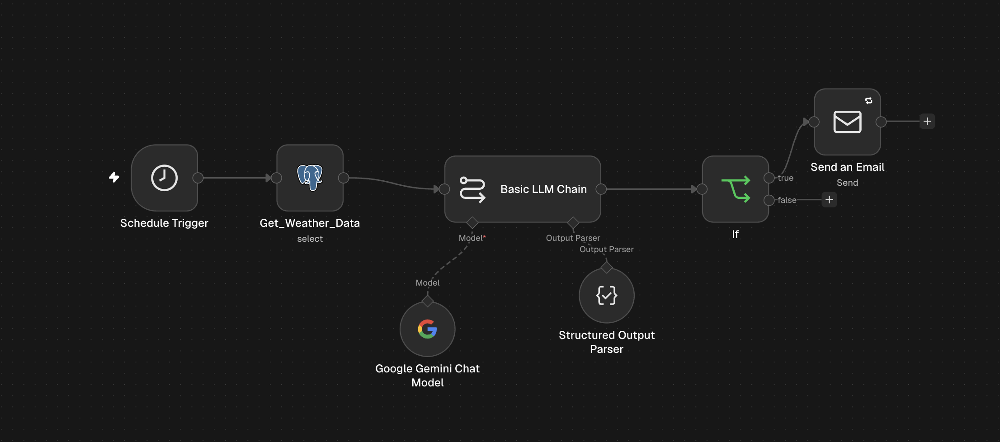
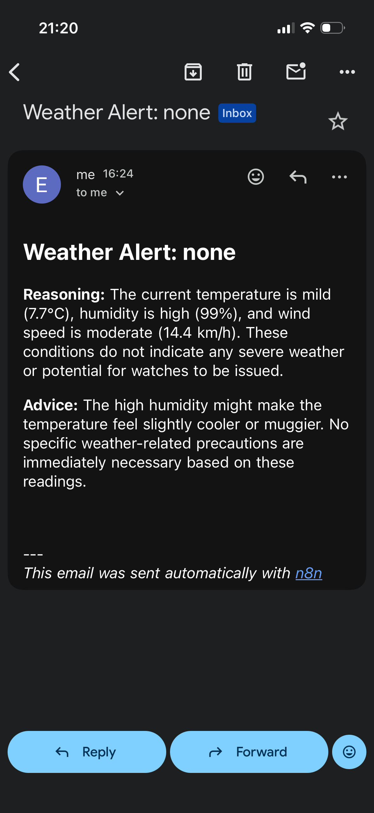

# n8n Weather Alert Automation

An automation workflow built in [n8n](https://n8n.io) that checks the latest weather reading in a PostgreSQL database, uses an LLM to classify conditions and generate advice, and sends an email alert only when conditions are notable.

Built on the same database as [Weather_api](https://github.com/jojo64-afk/Weather_api) and [Langgraph_Weather_Agent](https://github.com/jojo64-afk/Langgraph_Weather_Agent) — this automates a similar classify-and-advise pattern, but as a no-code/low-code scheduled workflow rather than a Python script.

## How it works



The workflow runs as:

```
Schedule Trigger → Get_Weather_Data → Basic LLM Chain (+ Structured Output Parser) → If → Send an Email
```

1. **Schedule Trigger** — runs on a daily schedule.
2. **Get_Weather_Data** — queries PostgreSQL for the most recent weather reading (sorted by ID, descending, limited to 1).
3. **Basic LLM Chain** — a Google Gemini chat model classifies the reading (`alert_level`: none / watch / severe, plus reasoning and advice), using a Structured Output Parser to guarantee a consistent, parseable JSON shape.
4. **If** — checks whether `alert_level` is anything other than `"none"`.
5. **Send an Email** — only fires when the If condition is true, so routine/boring weather doesn't generate noise, only genuinely notable conditions do.

### Example output



## Tech stack

- **n8n** (Cloud) — workflow orchestration
- **PostgreSQL** (hosted on [Neon](https://neon.tech)) — shared data source
- **Google Gemini** — LLM classification and advice generation
- **Gmail SMTP** — email delivery

## Files

- `WeatherAdvice-Agent.json` — the exported n8n workflow. Import via n8n's "Import from File" option to recreate the workflow (external credentials — Postgres and SMTP — will need to be reconnected).